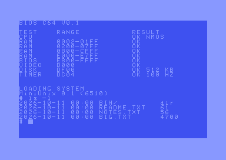
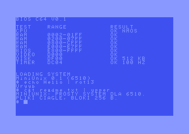
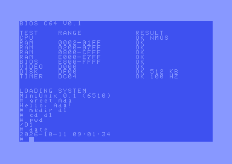
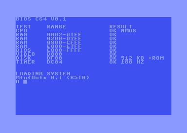
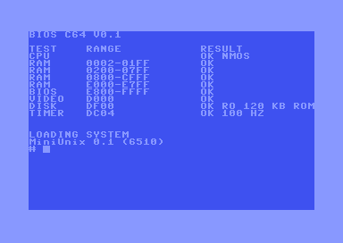
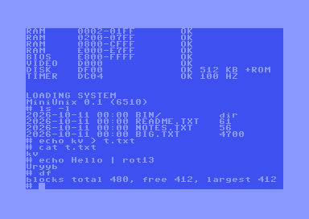
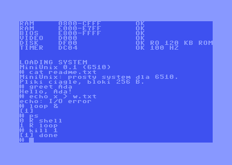
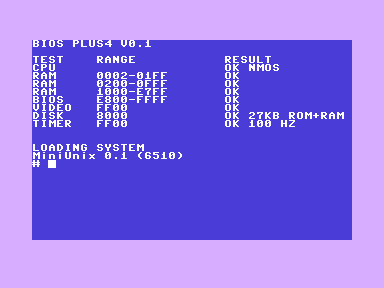
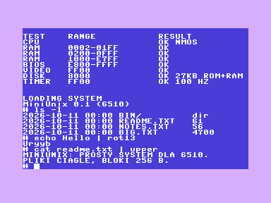
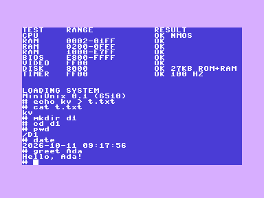

# mini6510

A BIOS and a small Unix-like operating system (**MiniUnix**) for a 64 KB, 6510-based 8-bit machine,
plus a Python machine model that boots and tests them — no hardware or emulator required.

The CPU itself is out of scope: this project defines and tests the **software-visible contract**
of the machine (memory map, I/O registers, BIOS entry points) and everything that runs on top of it.

```
BIOS 6510 V0.1

TEST    RANGE           RESULT
CPU                     OK NMOS
RAM     0002-01FF       OK
RAM     0200-D7FF       OK
RAM     E000-F7FF       OK
RAM     F800-FFFF       OK SHADOW
CONSOLE DF00            OK
DISK    DF10            OK 512 KB
TIMER   DF30            OK 100 HZ

LOADING SYSTEM
MiniUnix 0.1 (6510)
# ls -l
2026-10-11 14:45 BIN/         dir
2026-10-11 14:45 README.TXT   61
# cat big.txt | upper | cat > up.txt
```

## Features

**BIOS (2 KB ROM, shadowed into RAM)** — POST (zero page/stack, full RAM walk, ROM→RAM shadow copy),
console, 256-byte block device loader, timer check, jump table at `$F800` (see [docs/bios-api.md](docs/bios-api.md)).

**MiniUnix kernel (~7 KB at `$0400`)**
- SFS file system: files > 1 block, directories and paths (`/`, `.`, `..`), timestamps from a DS1307 RTC over I²C,
  largest-gap allocation, `defrag`, in-place append
- Shell: redirection (`>`, `>>`, `<`), pipes with streaming 255-byte buffers, background jobs (`&`), `^C`, quoting,
  `ls cd pwd mkdir rmdir cp mv rm touch df defrag date ps kill uptime …`
- Multitasking: up to 4 tasks, cooperative (`k_yield`) and pre-emptive on the timer IRQ
- Relocatable `.COM` programs with argc/argv, exit codes, stdin/stdout/stderr, `errno`-style messages
- Syscall ABI: [`os/sys.inc`](os/sys.inc)

## Screenshots (VICE, C64)

| Shell: `ls -l` with timestamps | Pipes: `rot13` and `upper` filters | Programs, directories, clock |
|---|---|---|
|  |  |  |

### Examples

```
# echo Hello | rot13
Uryyb
# cat readme.txt | upper
MINIUNIX: PROSTY SYSTEM DLA 6510.
# mkdir d1
# cd d1
# pwd
/D1
# date
2026-10-11 09:01:34
# loop &
[1]
# ps
```

## Quick start

```sh
sudo apt install cc65          # or: brew install cc65  (needs ca65/ld65)
pip install -r requirements.txt
python scripts/build.py        # -> build/bios.rom, build/kernel.bin, build/disk.img
python scripts/test.py         # builds and runs all suites (~2 min)
python scripts/run.py "ls\rcat readme.txt\recho hi | upper\r"   # boot and type keys, print the screen
```

If cc65 is not in `PATH`, set `CC65_HOME` to its root directory.

## Commodore 64 port

The same kernel runs on a real C64 memory map (`platforms/c64/`): PRG loaded with `LOAD"*",8,1` / `RUN`, BIOS copied to RAM,
VIC-II 40x25 console, CIA1 keyboard scan, CIA1 timer IRQ (~100 Hz), CIA1 TOD as RTC, disk image on a **REU** (1700/1764/1750).

```sh
python scripts/build.py --platform c64     # -> build/c64/mini6510.prg
python scripts/run_vice.py                 # window mode (needs VICE x64sc and a REU preloaded with build/c64/disk.img)
python tests/test_c64_vice.py              # headless VICE test (needs x64sc, Xvfb, xdotool; skipped when missing)
```

Caveats: tested in VICE with both stand-in ROMs and the original KERNAL 901227-03 / BASIC / charset (`C64_ROMS=<dir> python tests/test_c64_vice.py`, ROMs are not in the repo, `roms/` is git-ignored); date is fixed (2026-10-11), TOD starts at 09:00;
no IEC/1541/SD disk backend yet; PET is not supported. See [platforms/c64/test/README.md](platforms/c64/test/README.md).

### Cartridge (Magic Desk)

The whole system also boots from a **Magic Desk cartridge** (`build/c64/mini6510.crt`, 128 KB = 16 banks of 8 KB):
bank 0 holds the boot code and the BIOS, banks 1-15 hold a 120 KB read-only disk image (kernel, `/bin`, examples).
No `LOAD`/`RUN`, no disk drive: power on and get the `#` prompt.

```sh
python scripts/build.py --platform c64
x64sc -kernal kernal.bin -basic basic.bin -chargen chargen.bin -cartcrt build/c64/mini6510.crt          # read-only ROM disk
x64sc ... -reu -reusize 512 -cartcrt build/c64/mini6510.crt                                             # ROM disk copied to REU: writable
C64_ROMS=roms python tests/test_c64_cart.py    # VICE test with the original ROMs (skipped without them)
```

Screen right after power-on from the cartridge (POST, then the shell prompt):

| With REU (ROM disk copied to REU) | Without REU (read-only ROM disk) |
|---|---|
|  |  |

Working in the shell:

| Cartridge + REU (writable) | Cartridge only (read-only ROM disk) |
|---|---|
|  |  |

Details: [docs/c64.md](docs/c64.md#cartridge-magic-desk).

## Commodore Plus/4 port

MiniUnix also boots on the **Commodore Plus/4** (TED, 64 KB) from a 32 KB cartridge image (`build/plus4/mini6510-plus4.bin`,
CART-1 low + high). The original KERNAL finds the `CBM` signature at `$8007` and calls the cartridge at reset; the BIOS
takes over (RAM only, no KERNAL), prints the POST table and boots MiniUnix from a 27 KB disk stored in the cartridge ROM.
Writes go to a 6 KB RAM overlay (lost at reset), so `echo > file`, `mkdir`, `cp` of small files etc. work.

```sh
python scripts/build.py --platform plus4
xplus4 -kernal kernal.bin -basic basic.bin -functionlo functionlo.bin -functionhi functionhi.bin -cart build/plus4/mini6510-plus4.bin
PLUS4_ROMS=roms-plus4 python tests/test_plus4_cart.py   # VICE test with the original ROMs (skipped without them)
```

| POST and boot | Shell | Writes, directories, clock |
|---|---|---|
|  |  |  |

Details: [docs/plus4.md](docs/plus4.md).

## Layout

| Path | Contents |
|---|---|
| `bios/` | POST, console, block loader (ca65) and the BIOS ↔ OS register definitions (`bios.inc`) |
| `os/` | MiniUnix kernel, syscall ABI (`sys.inc`), linker configs, standard programs in `os/programs/` |
| `examples/` | Example programs (`greet`, `rot13`) and recorded console sessions |
| `sim/` | Python machine model: 6510 (py65), RAM/ROM shadow, console, block device, timer, I²C + RTC |
| `tools/` | `sfs.py` (disk image / SFS), `mkdisk.py`, `mkcom.py` (relocatable `.COM` builder) |
| `tests/` | End-to-end tests driving the real ROM and kernel through the simulated console |
| `scripts/` | `build.py`, `test.py`, `run.py` |
| `docs/` | Platform contract, architecture, decisions and verification notes (Polish) |

## Writing a program

Programs are relocatable `.COM` files loaded into 12 KB slots. Entry: `A` = argc, `X/Y` = argv table.
Exit with `RTS` (A = exit code) or `k_exit`. Free zero page: `$E0–$EF`.

```asm
        .include "sys.inc"
        .segment "CODE"
        lda #<msg
        ldx #>msg
        jsr k_puts
        lda #0
        rts
msg:    .byte "Hi!", 10, 0
```

Drop the file into `examples/programs/` (or `os/programs/`) and run `python scripts/build.py`;
it ends up in `/bin` on the disk image. See [`examples/`](examples/README.md).

## Status

Everything is verified against the **Python model** of the platform only. Running it on a real
6510 machine or another emulator requires that machine to honour the contract in
[docs/platform.md](docs/platform.md) (some items there are still marked "to be confirmed").
Known limits: no memory protection, no users/permissions, files ≤ 64 KB, polled console input.

## License

MIT — see [LICENSE](LICENSE).
