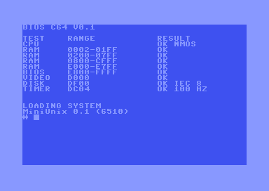
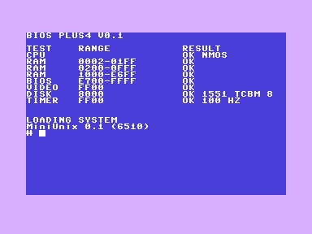
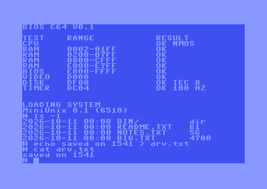
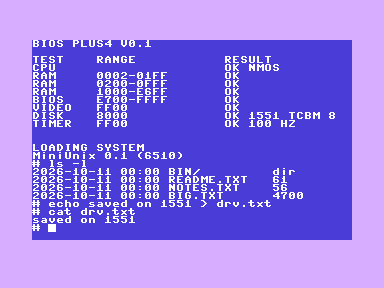

# Disk drives (IEC / 1541 and TCBM / 1551)

The BIOS can use a real disk drive as the block device. The kernel does not change: it still calls
`BIOS_ReadBlock` / `BIOS_WriteBlock` (X/Y = block, `ptr` = 256-byte buffer).

| C64 + 1541 (IEC) | Plus/4 + 1551 (TCBM) |
|---|---|
|  |  |
|  |  |

## Selection at POST
`IecInit` (bios/drive.s) probes unit 8 in up to 10 rounds (the drive may still be resetting; a round without a drive
takes about 0.3 s). Each round tries TCBM (Plus/4 only) and then IEC. A drive wins over the ROM/REU disk only when
block 0 carries the MiniUnix signature (`SF` at +$10). The result is `blk_dev` (0 = ROM/REU, 1 = drive) and `drv_tr`
(bit 7 = TCBM). POST prints `OK IEC 8` or `OK 1551 TCBM 8` in the DISK row. A drive with a foreign disk is ignored.

## Block layer (bios/drive.s, shared)
- Block n = drive sector n in linear order (T1/S0 first): 683 blocks for 1541/1551 (zones 21/19/18/17 sectors).
  `tools/mkdisk.py` therefore produces a valid `.d64` (174848 B, no error bytes) with `DISK_BLOCKS=683`.
  The system image occupies the whole disk including the directory track: it is a raw MiniUnix disk, not a CBM DOS disk.
- Read: `U1:5 0 t s`, status check (channel 15), `B-P:5 0`, TALK channel 5, 256 bytes.
- Write: `B-P:5 0`, LISTEN channel 5, 256 bytes, `U2:5 0 t s`, status check.
- Init: `OPEN 15,8,15` (secondary $FF), `OPEN 5,8,5,"#"` (secondary $F5, buffer channel).
- Errors: A=1 block out of range, A=3 bus/drive error (first status digit not `0`).

## IEC transport (bios/iec.s: C64 and Plus/4 with a 1541)
Bit-banged LISTEN/TALK/SECOND/CIOUT/ACPTR, same line protocol as the KERNAL (checked against its disassembly); no KERNAL
is used. Platform macros: `IEC_PORT` (C64 `$DD00`, Plus/4 `$01`), line masks, `IecHwInit`. Interrupts are masked per
byte only; the 100 Hz tick can be delayed during a transfer. Waits are long (up to ~8 s): a 1541 can take seconds to
answer after reset or after opening a channel. EOI is generated for the last byte and detected on receive (>200 us).

## TCBM transport (platforms/plus4/tcbm.s: Plus/4 with a 1551)
6525 TPI at `$FEF0` (unit 8). One transfer: command on PA (`$81` LISTEN/TALK/UNLISTEN/UNTALK, `$82` secondary,
`$83` data, `$84` receive), drive pulls ACK (PC7) low, host puts the byte on PA and strobes DAV (PC6 low), drive raises
ACK and reports status in PB bits 0-1 (receive: 3 = last byte). Taken from the Plus/4 KERNAL and the 1551 DOS
(`docs/disasm/dos1551.asm`). The host waits for ACK high before every command (the drive signals busy that way).

## Memory
Plus/4: the driver (segment `DRV`, ~1.6 KB) is part of the BIOS image, which is now 5 KB in c1lo and runs from `$E700`
(ROM disk: 104 blocks from `$9400`, write overlay 23 blocks `$D000-$E6FF`). C64: `DRV` runs at `$F900-$FFFF`.
RAM variables `$03C6-$03EF` (see each `hw.inc`).

## Testing (VICE, true drive emulation)
`tests/test_c64_drive.py` (x64sc, 1541-II, Magic Desk cartridge, no REU) and `tests/test_plus4_drive.py` (xplus4, 1551):
boot from the `.d64`, `ls`, multi-block read, write + read back, and the data is found in the image file afterwards.
ROMs needed (not in the repo): `dos1541.bin` (1541-II 251968-03) in `C64_ROMS`, `dos1551.bin` (318008-01) in `PLUS4_ROMS`.
VICE notes: `-autostart <d64>` switches the drive to virtual mode, so the tests start the cartridge instead; options used:
`-drive8type 1542 -dos1541II <rom> -drive8truedrive -8 <d64>` (C64) and `-drive8type 1551 -dos1551 <rom> ...` (Plus/4).

## Known limitations
Only unit 8, one drive, 1541/1551 geometry (no 1571/1581, no fast loaders). A 1541 on the Plus/4 IEC port is built in
but untested (VICE does not offer it with the same options). Real-hardware timing of the IEC bit loops is untested.
The plain C64 PRG with a drive is built but only the cartridge path is covered by a test.
